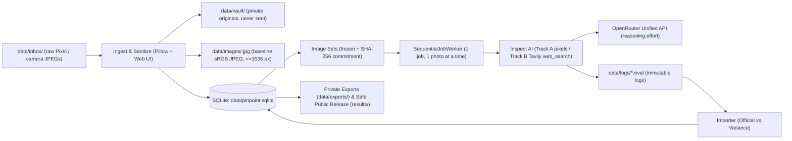

# Pinpoint Architecture & Methodology

Technical overview of the implemented `pinpoint-eval` benchmark harness.

## 1. System Architecture

## 2. Metadata & Contamination Controls

1. **Pixel-Only Re-encoding (`src/pinpoint/ingest.py`):**
   - Original photos move into `data/vault/` and are renamed on evaluation to opaque UUIDs (`<uuid>.jpg`).
   - Images sent to VLMs are orientation-baked, converted to sRGB RGB, scaled to `<= 1536 px` long edge, and re-encoded as clean baseline JPEGs (`quality=85`), removing EXIF/GPS tags, XMP blocks, ICC profiles, Ultra HDR gain maps, and Motion Photo MP4 trailers.
   - `pinpoint verify-clean` asserts empty `Image.info` / `getexif()` and absence of `ftyp` / `MotionPhoto` byte signatures.
2. **Pre-Run Commitments (`src/pinpoint/sets.py`):**
   - Freezing a set computes `SHA-256(salt | JSON({id, sha256_sanitized, lat, lon, country_iso2, continent}))`.
   - `results/<set>/commitment.json` publishes the commitment hash before evaluation while keeping `commitment_salt` private.
3. **Vendor Rotation Guard (`src/pinpoint/sets.py`):**
   - Prevents testing a second distinct `openrouter_id` from the same AI company on an already-tested set without an explicit override reason.
   - Sweeping OpenRouter `reasoning.effort` values (`none`, `minimal`, `low`, `medium`, `high`, `xhigh`, `max`) across configs sharing the same `openrouter_id` is allowed on the same set.
4. **Active-Set Public Redaction (`Option 1`, `src/pinpoint/charts.py` & `src/pinpoint/runner.py`):**
   - Public exports write only aggregate `summary.json`, `ranking_chart.svg`, `commitment.json`, `README.md`, and an origin-centered `bullseye_error.svg` (`0 km` center, km offset + bearing only—no absolute coordinates, countries, or photo IDs).

## 3. Sequential Execution & Scoring (`src/pinpoint/runner.py`, `src/pinpoint/geo.py`, `src/pinpoint/importer.py`)

- **Isolation:** `SequentialJobWorker` executes each queued job in an isolated subprocess (`python -m pinpoint.runner <job_id> <data_dir>`) with `max_samples=1` and `max_connections=1`.
- **Scoring:** WGS84 geodesic distance (`geographiclib`) feeds cumulative weights: Continent (`+1`), Country (`+2`), `<= 100 km` (`+3`), `<= 10 km` (`+4`), `<= 1 km` (`+5`) for a max of `15` points, alongside `<= 100 m`, `<= 10 m`, IM2GPS (`25/200/750/2500 km`), Strict vs Adjusted means, Refusal rate, and smooth log-distance score (`5000 * exp(-d / 1492.7)`).
- **Official vs Variance:** First valid recorded result (`epoch == 1`) per `(set_id, track, model_config_id, photo_id)` is `is_official = 1`; manual single-photo reruns and repeats are recorded as `is_official = 0` (`Variance`).
