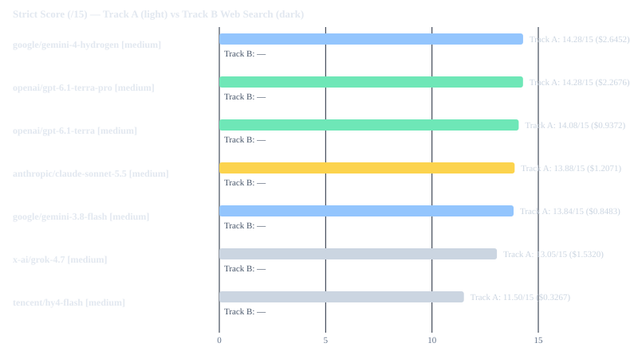
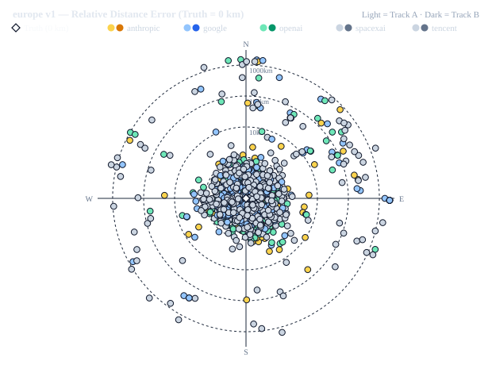

# Pinpoint Results — europe v1

- **Photos:** 208
- **Frozen At:** `2026-11-17T14:30:22.803289+00:00`
- **Commitment Hash (`SHA-256`):** `42b0458fee23b6032af8b3e4a62caad6ba5437a76eeeba732241371e167e9bc0`
- **Public Map Policy:** Relative bullseye error only (ground-truth coordinates withheld while set is active).

## Track A — Pixels Only

| # | Model (Reasoning Effort) | Strict (/15) | Adjusted (/15) | Median km | Country % | ≤10 km % | ≤1 km % | Total Time | Mean Latency | Reasoning Tok | Cost |
|---:|---|---:|---:|---:|---:|---:|---:|---:|---:|---:|---:|
| 1 | `google/gemini-4-hydrogen [medium]` | **14.28** | 14.28 | 0.059 | 96% | 95% | 93% | 35.4m | 10.20s | 1292 | $2.6452 |
| 2 | `openai/gpt-6.1-terra-pro [medium]` | **14.28** | 14.28 | 0.108 | 97% | 96% | 91% | 87.6m | 25.27s | 1087 | $2.2676 |
| 3 | `openai/gpt-6.1-terra [medium]` | **14.08** | 14.08 | 0.098 | 96% | 94% | 90% | 42.9m | 12.39s | 372 | $0.9372 |
| 4 | `anthropic/claude-sonnet-5.5 [medium]` | **13.88** | 13.88 | 0.168 | 96% | 94% | 87% | 10.4m | 3.01s | 0 | $1.2071 |
| 5 | `google/gemini-3.8-flash [medium]` | **13.84** | 13.84 | 0.083 | 95% | 92% | 89% | 34.6m | 9.98s | 726 | $0.8483 |
| 6 | `x-ai/grok-4.7 [medium]` | **13.05** | 13.05 | 0.187 | 92% | 88% | 80% | 55.0m | 15.85s | 482 | $1.5320 |
| 7 | `tencent/hy4-flash [medium]` | **11.50** | 11.61 | 0.481 | 84% | 76% | 66% | 276.3m | 79.70s | 10686 | $0.3267 |

## Track B — Web Search

_No official runs recorded yet._
